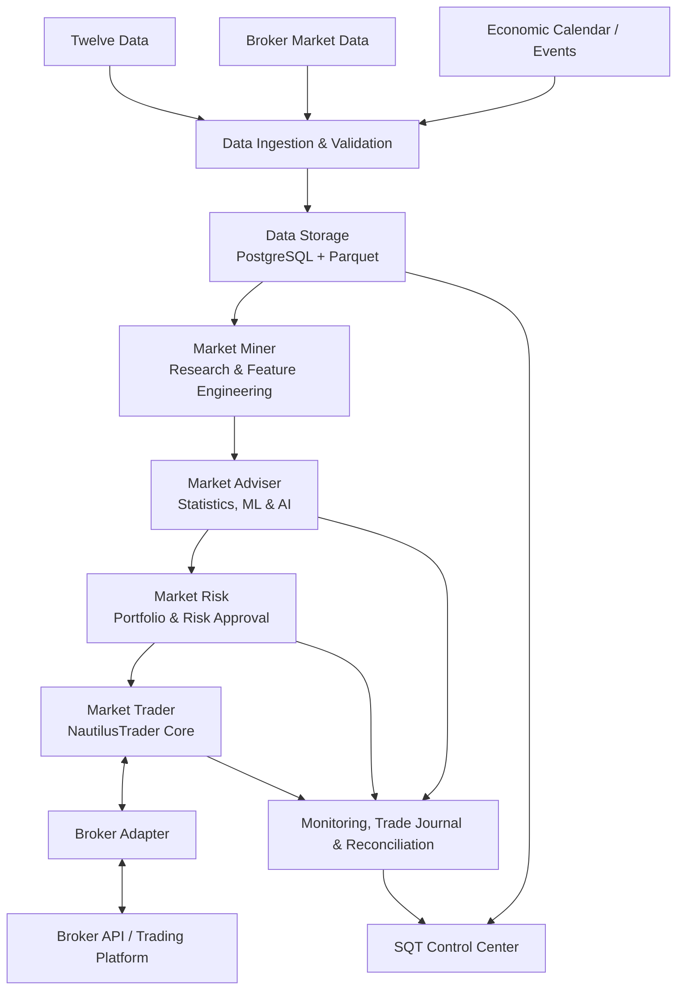

<!--
  Smart Quant Trading (SQT)
  Powered by MART
  Project documentation — architecture and roadmap
-->

<div align="center">

# SQT
### Smart Quant Trading

**Powered by MART**

*Private Quantitative Research & Trading Platform*

<p>
  
  
  
  
</p>

**Research. Understand. Control Risk. Execute.**

[Architecture](#-architecture) · [Modules](#-core-modules) · [Roadmap](#-development-roadmap) · [Technology](#-technology-stack) · [Principles](#-engineering-principles)

</div>

---

> [!NOTE]
> **Project status: Foundation / Phase 0 planned.** This README describes the target architecture and development roadmap. A capability listed here is a design objective, not a claim that it has already been implemented or validated.

## ✦ Overview

**Smart Quant Trading (SQT)** is a private, modular quantitative trading platform designed for research, analysis, risk management, and execution across the **Forex and CFD markets**.

SQT is being designed around a disciplined swing-trading workflow. It brings four coordinated modules together under one platform:

- **Market Miner** — market data, quantitative research, and feature discovery.
- **Market Adviser** — statistical analysis, model-based probabilities, and AI-assisted interpretation.
- **Market Risk** — portfolio exposure, position sizing, and independent risk controls.
- **Market Trader** — broker connectivity, order execution, and position lifecycle management.

The platform is intended for personal use and self-hosted operation. Its architecture prioritizes reproducible research, realistic simulation, traceable decisions, and safe execution over simplistic “always-on” trading signals.

## 🎯 Project Objectives

- Build a unified research-to-execution workflow for Forex and CFD instruments.
- Separate data acquisition, quantitative research, signal analysis, risk approval, and execution.
- Use **NautilusTrader** as the primary event-driven trading and backtesting engine.
- Preserve **Twelve Data** as an external market-data source, while allowing broker-native data to be added.
- Store operational records in a relational database and large historical datasets in columnar files.
- Evaluate strategies with out-of-sample and walk-forward methods before any live deployment.
- Keep execution safeguards independent from AI services and research components.

## 🧭 Architecture

The platform is planned as a **modular monolith** first: clear internal boundaries and interfaces, without introducing distributed-service complexity before it is needed.



### Trading decision lifecycle

1. **Ingest:** collect and validate historical and live market data.
2. **Research:** calculate features, examine market regimes, and investigate strategy hypotheses.
3. **Analyze:** estimate and calibrate scenario probabilities; produce explainable signal records.
4. **Approve risk:** evaluate portfolio-level exposure, margin, and configured risk limits.
5. **Execute:** submit approved orders through the selected broker adapter.
6. **Reconcile:** compare internal order and position state with the broker's authoritative state.
7. **Learn:** evaluate realized performance and monitor model or strategy drift.

## 🧩 Core Modules

### 01 · Market Miner

**Quantitative Research & Data Intelligence**

Responsibilities:

- Historical and live data ingestion coordination.
- Data quality checks, normalization, and timestamp alignment.
- Feature engineering and technical/statistical measurements.
- Market-regime and volatility analysis.
- Pattern and strategy hypothesis research.
- Reproducible datasets and experiment records.

**Primary output:** versioned research datasets, features, and experiment results.

### 02 · Market Adviser

**Statistical Intelligence & Decision Support**

Responsibilities:

- Multi-timeframe analysis, initially emphasizing Daily, 4-hour, and 1-hour views.
- Statistical and machine-learning model evaluation.
- Buy/sell scenario probability estimation and calibration.
- Signal confidence, evidence, and invalidation conditions.
- AI-assisted explanation and research summaries.

**Primary output:** structured, timestamped signal and scenario assessments.

> Probabilities must be empirically calibrated and tied to a defined event and horizon. They are not guarantees of future returns. The system must be able to return **no actionable setup**.

### 03 · Market Risk

**Portfolio, Exposure & Capital Protection**

Responsibilities:

- Risk-based position sizing.
- Instrument, currency, and portfolio exposure.
- Correlation and concentration monitoring.
- Margin and available-equity checks.
- Drawdown and portfolio-risk limits.
- Pre-trade approval or rejection.
- Runtime risk supervision and emergency controls.

**Primary output:** an auditable risk decision and approved order constraints.

Market Risk is not merely a one-time step before execution. It must also supervise open exposure continuously and remain independent of AI availability.

### 04 · Market Trader

**Order Execution & Position Lifecycle**

Responsibilities:

- NautilusTrader integration.
- Broker adapter abstraction.
- Order submission, modification, and cancellation.
- Fill, rejection, and partial-fill handling.
- Stop-loss and take-profit lifecycle.
- Position and account reconciliation.
- Connection recovery and duplicate-order protection.

**Primary output:** broker-confirmed order, fill, and position events.

The broker remains authoritative for actual account, order, and position state. An internal order request must never be treated as a confirmed fill.

## 🛠 Technology Stack

| Area | Planned technology | Purpose |
|---|---|---|
| Trading & backtesting | **NautilusTrader** | Event-driven simulation and execution |
| Research | Python, NumPy, Pandas | Quantitative analysis |
| Optional research acceleration | VectorBT | Fast vectorized strategy exploration |
| Machine learning | Scikit-learn, LightGBM | Statistical and ML models |
| AI integration | Provider-independent LLM interface | Interpretation and reporting |
| Market data | Twelve Data + broker data | Historical and live market inputs |
| Operational database | PostgreSQL | Accounts, configurations, signals, orders, and audit records |
| Historical storage | Apache Parquet | Columnar market-data storage |
| Backend API | FastAPI | Internal and UI-facing APIs |
| Frontend | Vue 3 | SQT Control Center |
| Visualization | Plotly | Charts and quantitative reports |

**VectorBT is an optional research tool, not a database and not a replacement for Twelve Data or NautilusTrader.** It may be introduced when large-scale parameter or signal exploration justifies a separate vectorized workflow.

The exact broker, adapter, data entitlements, and deployment topology remain open decisions.

## 🔌 Broker & Data Connectivity

SQT will use adapter boundaries to avoid coupling its internal domain model to one broker.

The selected broker must be evaluated for:

- Supported account entity and jurisdiction.
- Forex and CFD instrument availability.
- Official API access and API permissions.
- Historical bars, bid/ask quotes, and tick-data availability.
- Order types, partial fills, and execution reporting.
- Contract specifications, tick size, lot size, and minimum volume.
- Spread, commission, swap/rollover, margin, and trading sessions.
- Demo environment and operational reliability.

Potential integration paths include broker-native REST/WebSocket/FIX APIs and trading-platform APIs such as MetaTrader or cTrader, subject to the selected broker's terms and technical capabilities.

**No broker has been selected yet.** Twelve Data is retained as a planned data source; broker-native prices and contract specifications will be incorporated wherever required for realistic simulation and execution.

## 🧪 Research & Validation Workflow

Strategies must pass a repeatable validation process before they can be considered for live use:

1. Define the hypothesis, instruments, timeframe, and event being predicted.
2. Validate source data and instrument metadata.
3. Prevent look-ahead bias and data leakage.
4. Split research, validation, and untouched out-of-sample periods chronologically.
5. Use walk-forward evaluation and regime-aware analysis.
6. Model spread, commission, slippage, swap, margin, and execution constraints.
7. Review trade count, expectancy, profit factor, drawdown, Sharpe/Sortino, and exposure.
8. Calibrate probabilities and inspect calibration quality.
9. Run paper trading and compare simulated versus observed execution.
10. Permit live deployment only after explicit review and risk configuration.

A strategy's historical performance is not a promise of future results. Optimization must be controlled to reduce overfitting and selection bias.

## 🗺 Development Roadmap

| Phase | Scope | Main deliverable | Status |
|---|---|---|---|
| **0** | Foundation & architecture | Repository structure, environment, interfaces, standards | Planned |
| **1** | Market Data Engine | Twelve Data/broker ingestion, validation, PostgreSQL, Parquet | Planned |
| **2** | Market Miner | Features, statistics, regimes, research experiments | Planned |
| **3** | Nautilus Backtesting | Event-driven backtests and realistic cost models | Planned |
| **4** | Market Adviser | Calibrated probabilities, ML, AI-assisted analysis | Planned |
| **5** | Market Risk | Position sizing, exposure, margin, risk controls | Planned |
| **6** | Broker Adapter & Paper Trading | Broker integration, reconciliation, demo execution | Planned |
| **7** | Live Trading & Control Center | Monitored deployment, dashboard, audit and reporting | Planned |

### Phase exit criteria

- **Phase 0:** project installs reproducibly; module boundaries and contracts are documented.
- **Phase 1:** data is validated, timestamped, traceable, and reproducibly stored.
- **Phase 2:** research experiments can be repeated from versioned inputs and parameters.
- **Phase 3:** backtests account for instrument and execution costs and pass leakage checks.
- **Phase 4:** model outputs are calibrated, versioned, and explainable.
- **Phase 5:** risk rules are deterministic, tested, and capable of rejecting orders.
- **Phase 6:** demo orders, fills, disconnects, and reconciliation are tested end-to-end.
- **Phase 7:** live operation is explicitly enabled, monitored, and protected by independent safeguards.

## 🛡 Engineering & Safety Principles

- **No look-ahead bias:** decisions may use only information available at decision time.
- **No silent data leakage:** training and evaluation boundaries are explicit.
- **Risk before execution:** every new order must pass deterministic risk checks.
- **Broker-state reconciliation:** broker-confirmed state is authoritative.
- **Idempotent execution:** retries must not create duplicate orders.
- **Fail-safe behavior:** AI or research outages must not disable essential open-position protection.
- **Independent kill switch:** new order submission can be stopped immediately.
- **Secrets stay private:** API keys and credentials must never be committed to Git.
- **Traceability:** signals, model versions, risk decisions, order events, and fills are auditable.
- **Human oversight:** live deployment and material risk changes require explicit operator control.

## 📁 Planned Repository Layout

```text
Smart-Quant-Trading/
├── apps/
│   ├── api/
│   └── control-center/
├── modules/
│   ├── market-miner/
│   ├── market-adviser/
│   ├── market-risk/
│   └── market-trader/
├── core/
│   ├── data/
│   ├── events/
│   ├── instruments/
│   ├── interfaces/
│   └── models/
├── engines/
│   ├── nautilus/
│   ├── research/
│   └── machine-learning/
├── adapters/
│   ├── brokers/
│   └── data-providers/
├── strategies/
├── infrastructure/
│   ├── database/
│   ├── storage/
│   ├── logging/
│   └── monitoring/
├── configs/
├── scripts/
├── tests/
│   ├── unit/
│   ├── integration/
│   ├── backtest/
│   └── execution/
├── docs/
├── pyproject.toml
└── README.md
```

## 🔐 Privacy & Deployment

SQT is designed for private, self-hosted operation. The deployment target and hardware allocation will be finalized as the project progresses.

The platform should support local persistence, controlled network access, encrypted broker credentials, least-privilege API permissions, and separate research, paper-trading, and live configurations.

## 📚 References

- [NautilusTrader Documentation](https://nautilustrader.io/docs/latest/)
- [NautilusTrader GitHub](https://github.com/nautechsystems/nautilus_trader)
- [Twelve Data Documentation](https://twelvedata.com/docs)
- [VectorBT Documentation](https://vectorbt.dev/)
- [PostgreSQL Documentation](https://www.postgresql.org/docs/)
- [Apache Parquet Documentation](https://parquet.apache.org/docs/)
- [FastAPI Documentation](https://fastapi.tiangolo.com/)
- [Vue Documentation](https://vuejs.org/)

---

<div align="center">

**SQT — Smart Quant Trading**  
*Powered by MART*

**Research with discipline. Trade with control.**

</div>
